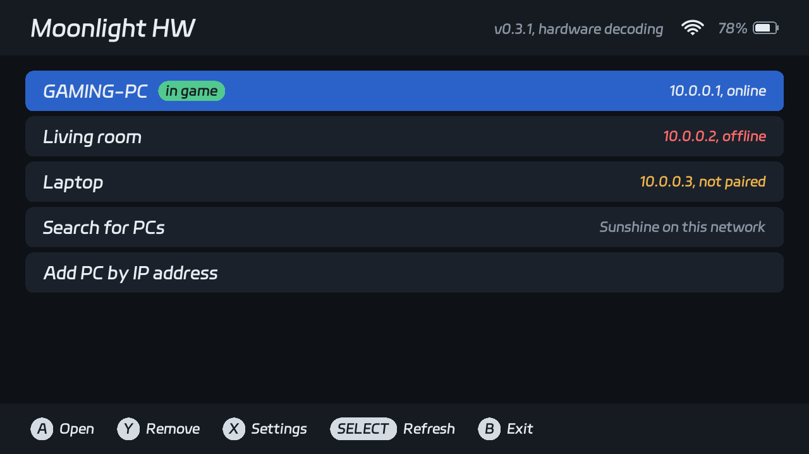
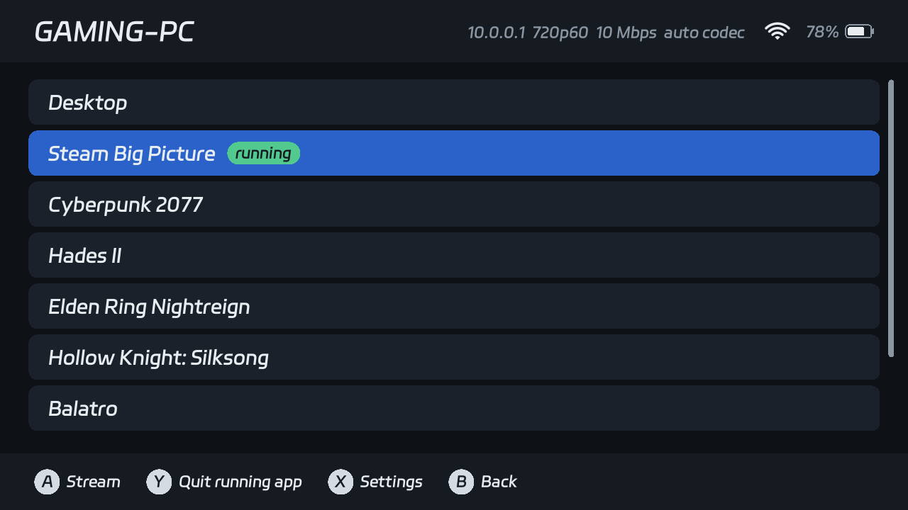
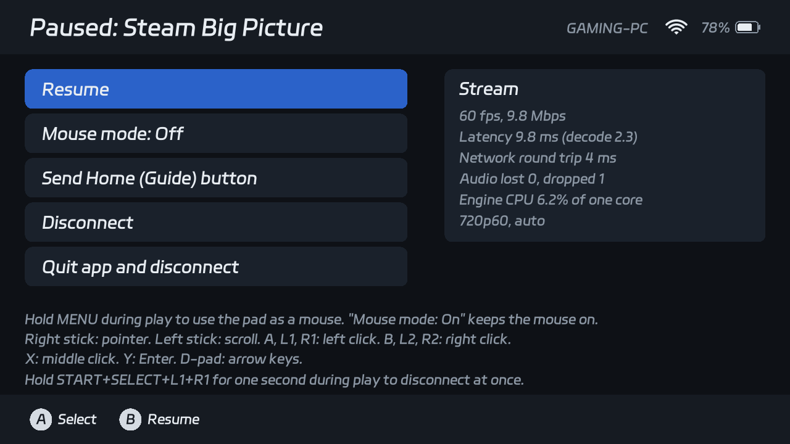
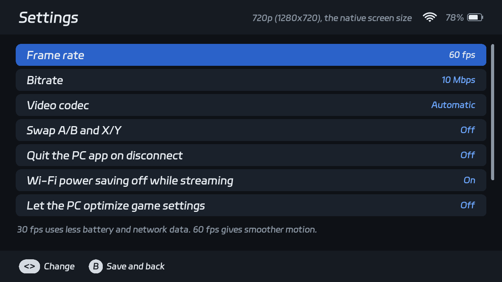

# moonlight-tsp

moonlight-tsp is a Moonlight game-streaming client for the TrimUI Smart Pro
(Allwinner A133P). It decodes the video in hardware. It streams from PCs
with Sunshine (or GeForce Experience). On CrossMix-OS, you install it as the
app "Moonlight HW".

Other Moonlight builds for this handheld decode in software with FFmpeg.
Then they upload each frame through the GPU. moonlight-tsp sends the stream
to the Cedar video engine of the SoC. G2D rotates each picture to fit the
portrait panel, and a display-engine layer shows it. The CPU never touches
the pixels.

Status: early. The only test device is one TrimUI Smart Pro with
CrossMix-OS 1.3.0. Expect some problems.

## Screenshots

| Saved PCs | Apps on a PC |
|---|---|
|  |  |

| Stream menu (press MENU) | Settings |
|---|---|
|  |  |

These images are the real screens of the app, at the 1280x720 size of the
handheld screen. `scripts/ui-screens.sh` made them with sample PCs and a
test script in place of the stream engine. The figures in the stream menu
are sample values, not measurements. The images do not show the game,
because the game plays on a display layer. A screenshot of the interface
does not include that layer.

## Compared with the stock client

The stock client is the Moonlight app that comes with CrossMix-OS. It is
Moonlight Embedded 2.6.1 (2023), with a front end from TrimUI. Moonlight
New from PortMaster also decodes in software.

| | Stock client | moonlight-tsp |
|---|---|---|
| Video decoding | Software (FFmpeg) on the CPU. Then the client uploads each frame to the GPU. | The Cedar video engine of the SoC. G2D rotates the picture, and a display layer shows it. |
| CPU clock | The launcher holds the CPU at 1.6 GHz (`performance` governor). | No changes to the CPU settings |
| Audio | Through the system mixer, with about 85 ms of buffering | Directly to the codec in 5 ms periods, with a 40 ms buffer. The volume keys still change the volume. |
| Moonlight code | Moonlight Embedded 2.6.1 | moonlight-common-c and libgamestream from November 2026, with OpenSSL 3.5 |

Measurements on the device at 1280x720 and 60 fps:

- Local test streams: each frame is on the screen about 4.5 ms after the
  client sends it to the decoder. The decoder adds no frames of lag. This
  uses about 7% of one CPU core. During a 10-minute test, the memory use
  did not increase.
- Live stream from Sunshine: the full client uses about 19% of one core.
  Audio uses the largest part, about 9%. The 9% value is from a test with
  the slower shared audio path.
- Wi-Fi power saving: the client turns it off during a stream. In a test
  during video, this change decreased the average ping time to the router
  from 59 ms to 12.5 ms. It also decreased the longest stall (a time with
  no traffic) from 1.8 s to 0.13 s.

There is no side-by-side test against the stock client yet. Thus there
are no figures for the CPU time or the battery power that moonlight-tsp
saves.

## Features

- H.264 and HEVC video at 1280x720 (the native size of the panel), 30 or
  60 fps, and 5-30 Mbps
- Hardware decoding (Cedar), G2D rotation and a display-engine video layer,
  with no frame of decoder lag
- ALSA audio with low latency. The system volume keys still change the
  volume.
- Its own UI, made for the controller. In this UI, you can search for PCs
  (mDNS), add a PC by its IP address, pair with a PIN, and change the
  settings. You can also start an app from the app list, and resume or
  quit the app that is open on the PC.
- Pairing data from the stock Moonlight app. At its first start, Moonlight
  HW copies this pairing, so a PC that is already paired does not need a
  new PIN.
- A stream menu (press MENU) with Resume, Mouse mode, Send Home (Guide)
  button, Disconnect, and Quit app and disconnect. If you hold
  START+SELECT+L1+R1 for one second, the client disconnects at once.
- Mouse mode, while you hold MENU or after you set "Mouse mode: On" in the
  stream menu. The right stick moves the pointer, and the left stick
  scrolls. A, L1 and R1 give a left click. B, L2 and R2 give a right click.
  X gives a middle click, Y sends Enter, and the D-pad sends the arrow keys.
- A separate process for the stream engine, with a watchdog in the UI. If
  the engine does not respond, the watchdog stops it, and the UI shows a
  message. The device does not freeze.
- No changes to the CPU governor
- Wi-Fi power saving off during a stream, and on again after it. A setting
  controls this.
- Updates from GitHub. When the app starts, it checks for a newer version
  and asks you before it installs it. A setting turns off this check.
- Battery level and Wi-Fi signal at the top right of the menus and of the
  stream menu. The app reads them every 5 seconds, and never during a
  stream. It does not start a Wi-Fi scan to get the signal.

## Requirements

- A TrimUI Smart Pro with CrossMix-OS. CrossMix-OS 1.3.0 is the only
  tested version.
- A PC with [Sunshine](https://github.com/LizardByte/Sunshine), on the same
  network as the handheld. Sunshine is the only tested streaming server.

## Install

1. Download the latest `trimui-moonlight-tsp-<version>.zip` from the
   Releases page.
2. Turn off the handheld.
3. Put the SD card of the handheld into your computer.
4. Extract the zip to the root of the SD card. The zip holds
   `Apps/MoonlightTSP/`, so the app goes into the `Apps` folder of the
   card.
5. Some unzip tools put the files into an extra folder with the name of
   the zip. If your tool does this, move `MoonlightTSP` into the `Apps`
   folder of the card.
6. Put the SD card back into the handheld.
7. Turn on the handheld.
8. Open "Moonlight HW" from the Apps menu.

From version 0.3.0, the app updates itself (see [Updates](#updates)). You
can also install a newer zip with the same steps. The new files replace
the old files. The app keeps its settings, pairing data and logs in the
internal storage of the handheld, in
`/mnt/UDISK/trimui-tools/moonlight-tsp/`. Thus an update does not erase
them.

To remove the app, delete `Apps/MoonlightTSP/` from the SD card. If the
card has a `.moonlight-tsp-update` folder, delete it too. Then delete
`/mnt/UDISK/trimui-tools/moonlight-tsp/` from the internal storage, for
example over SSH. The PC shows the handheld as paired until you remove
the handheld in Sunshine.

## First use

### Add your PC

If there are no saved PCs, the app opens "Search for PCs". This screen
lists the Sunshine PCs on your network and shows if each PC is paired.
Press A on your PC to add it.

If your PC is not in the list, add it by its IP address:

1. Press B to go to the PC list.
2. Press A on "Add PC by IP address".
3. Type the IP address of the PC. A types the selected key, and Y deletes
   the last character.
4. Press START to save the address.

### Pair with the PC

1. In the PC list, press A on the PC. If the PC is not paired, the app
   shows a four-digit PIN and the name and address of the PC.
2. Open the PIN page in the Sunshine web UI of that PC.
3. Type the PIN on that page. You can use a device name of your choice.

When the PC accepts the PIN, the app list of the PC opens. The PIN screen
waits for 5 minutes at most.

If the stock Moonlight app is paired with a PC, Moonlight HW copies that
pairing at its first start. The search then shows the PC as paired, and
you do not need a PIN for it.

### Start a stream

In the app list, press A on a game or an app. If a different app is open
on the PC, Moonlight HW asks you before it quits that app.

| Screen | Buttons |
|---|---|
| PC list | A open, Y remove the PC from the list, X settings, SELECT refresh the status of all PCs, B exit the app |
| App list | A start or resume, Y quit the app that is open on the PC, X settings, B back |
| Stream | Press MENU for the stream menu (B resumes the stream). Hold MENU to use the pad as a mouse. To disconnect at once, hold START+SELECT+L1+R1 for one second. |

### Settings

To open the settings, press X in the PC list or in the app list.

| Setting | Default | Other values |
|---|---|---|
| Frame rate | 60 fps | 30 fps |
| Bitrate | 10 Mbps | 5 to 30 Mbps |
| Video codec | Automatic | HEVC, H.264 |
| Swap A/B and X/Y | Off: the bottom button sends A, as on an Xbox pad | On: each button sends its printed letter |
| Quit the PC app on disconnect | Off | On |
| Wi-Fi power saving off while streaming | On (recommended) | Off |
| Let the PC optimize game settings | Off | On |
| Check for updates at start | On | Off |
| Check for updates now | Shows the installed version. Press A to check. | |

## Updates

From version 0.3.0, the app can update itself over Wi-Fi.

- When the app starts, it asks GitHub for the newest release. It asks
  only when it is not busy, and never during a stream. If there is a
  newer version, the app shows the version number, a summary of the
  changes and the download size. Select Update, Later or Skip. Later is
  selected first, so an accidental A press does not start an update. Skip
  stops the offers for that version only.
- To check at any time, open Settings and press A on "Check for updates
  now". This check also shows a version that you skipped.
- Update downloads the zip (about 4 MB) to the SD card. The app checks
  the size and the SHA-256 of the zip, unpacks it, and makes sure that
  the new programs start on the handheld. Then the app replaces
  `Apps/MoonlightTSP/` and starts again. Your settings, pairing data and
  logs stay the same.
- If the new version does not start, the app puts the old version back.
  Then it shows a message. It does not offer that version again at start.

Each check gets one small file over HTTPS from github.com, which sends the
request on to the file server of GitHub. A download uses the same servers.
The requests send the app version (`moonlight-tsp/0.3.0` as the
User-Agent) and no other data from the handheld. As with all web
requests, GitHub sees the public IP address of your network. To stop the
checks, set "Check for updates at start" to Off.

The releases are not signed. The app trusts a release because it comes
over HTTPS from this GitHub repository. The root certificates of the
handheld verify the connection. The SHA-256 check finds only damaged
downloads.

## Troubleshooting

### Pairing does not complete

This section also applies if Sunshine says that no device waits for
pairing. The app sends the pairing request only to the PC that the PIN
screen names. Type the PIN in Sunshine on that PC within 5 minutes. If the
pairing does not complete, open the PC again in the PC list to get a new
PIN.

### A PC shows as offline

Make sure that the PC and Sunshine are on. Then press A on the PC to try
again. To refresh the status of all PCs, press SELECT.

### The PC list shows a CPU Performance message

The message "The CPU Performance scene is on. It uses more battery." at
the top of the PC list shows that the CPU Performance scene of the
handheld is on. This scene holds the CPU at 2 GHz in all
apps. Moonlight HW never changes the CPU settings. If you want a longer
battery life, turn off the scene on the handheld.

### An update fails

The message gives the reason. Make sure that Wi-Fi is on and that the SD
card has free space, then try again with "Check for updates now".
`update.log` has the details (see [Logs](#logs)). You can also install
the new zip by hand (see [Install](#install)).

### The app is missing after an update

This can occur only if the handheld lost power while the app replaced its
folder. To repair it, put the SD card into your computer. Move the folder
`.moonlight-tsp-update/previous` in the root of the card to
`Apps/MoonlightTSP`. The name starts with a dot, so some computers do not
show the folder. You can also install the zip again.

### A stream stops with a message

The message gives the reason. If the PC does not answer for about 10
seconds, the stream stops by itself. If the stream engine does not
respond, the watchdog stops it and writes `hang.log`. Thus the handheld
does not freeze.

### Logs

The logs are in `/mnt/UDISK/trimui-tools/moonlight-tsp/logs/`. The folder
has `ui.log`, `launcher.log`, `engine.log`, `stream.log` and `update.log`
(update checks and downloads). Each of these logs has a `.1` copy from the
previous session. `install.log` has a line for each step of each update.
If the watchdog stopped a stream, the folder also has `hang.log`. If you
report a bug, attach these logs to the report.

## Build

To build the app, you need Docker with `linux/arm64` support. This
support is native on Apple silicon and comes from QEMU on other
computers. To make the package, you also need `zip`, `shasum` and
ImageMagick (`magick`) on your computer.

```sh
sh scripts/fetch-third-party.sh          # pinned sources, SHA-256 checked
sh scripts/docker-build.sh -j8 engine ui # binaries in build/
sh scripts/docker-build.sh check         # host-side tests
sh scripts/package.sh                    # dist/trimui-moonlight-tsp-<version>.zip
```

The build uses a Debian bullseye container. Thus the binaries need only
glibc 2.30, and the device has glibc 2.33. The build links OpenSSL, curl,
expat, uuid and Opus statically. It links ALSA and the SDL2/SDL2_ttf
libraries of the device dynamically. The stream engine loads the vendor
CedarC libraries at run time.

The build is reproducible: the same sources always give the same files.
The build pins the build date of OpenSSL and the Debian base image. Thus a
clean checkout gives the released binaries byte for byte, and two package
builds give the same zip. ImageMagick on your computer makes the icon.
Thus a different ImageMagick version can change `icon.png`.

`scripts/ui-screens.sh` makes an image of each UI screen in the container,
without a device. The four images in the Screenshots section come from
this script. `scripts/update-test.sh` tests the updater in the container,
with a local HTTPS server in place of GitHub.

To make a release, add a section for the version to `CHANGELOG.md` and
set `UI_VERSION` and `ENGINE_VERSION` to the version. Then commit.
`scripts/release.sh VERSION` builds the zip and its `update.txt` and
writes the release notes, but publishes nothing. `scripts/release.sh
VERSION --publish` also tags the commit, pushes it and makes the GitHub
release. All installed copies then offer the release at their next start.

## Layout

| Path | Contents |
|---|---|
| `src/stream_main.c` | `moonlight-tsp-stream`: the stream engine, also a CLI (`info`, `list`, `pair`, `stream`, `quit`, `reset-display`, `update-check`, `update-fetch`) |
| `src/video_cedar.c`, `cedar*.c`, `g2d_rot.c`, `disp.c`, `ion.c` | video: Cedar decode, G2D rotation, display layer, ION buffers |
| `src/audio_alsa.c`, `src/input_evdev.c`, `src/wifi_ps.c` | audio, controller and mouse input, Wi-Fi power saving |
| `src/update.c`, `src/update_manifest.c` | updates: the GitHub check, the download, its checks and the stage folder |
| `src/ui_*.c` | `moonlight-tsp-ui`: the SDL2 interface, with the battery and Wi-Fi status (`ui_status.c`) |
| `include/` | vendor ABI headers (CedarC 1.3.0, sunxi disp2, G2D) with layout checks |
| `package/` | launcher, installer for updates (`update.sh`) and icon |
| `tests/` | tests for the build computer (`make check`), the UI screen script and the updater tests |
| `scripts/` | fetch, build, package, screenshot, updater test and release scripts |
| `CHANGELOG.md` | changes in each version; the first line of each section is the summary that the app shows |
| `tools/` | device test tools (`tsp-videotest`, `tsp-probe`, `tsp-mdns`) |
| `docs/development-notes.md` | design, measurements and development log |

## License and credits

The license is GPL-3.0-or-later (see `LICENSE`). The stream protocol comes
from
[moonlight-common-c](https://github.com/moonlight-stream/moonlight-common-c).
Pairing and the app list use `libgamestream` from
[moonlight-embedded](https://github.com/moonlight-stream/moonlight-embedded).
`third_party.lock` pins the exact versions of these libraries and of enet,
nanors, OpenSSL and curl. The license notices of these libraries are in
the `licenses/` folder of the package.

The design uses ideas from
[moonlight-allwinner-h618](https://github.com/uselesscodestoo/moonlight-allwinner-h618)
(branch `k2b-cedarc-disp`). That project shows Cedar-decoded video on a
display layer on the H618, with a newer CedarC and kernel.

This project is independent of the Moonlight project, TrimUI and
CrossMix-OS.
